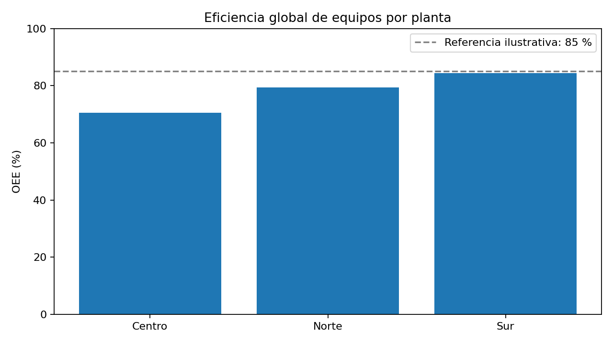
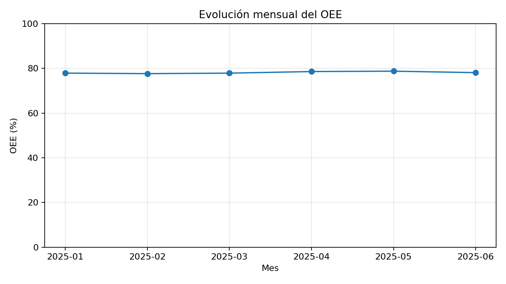
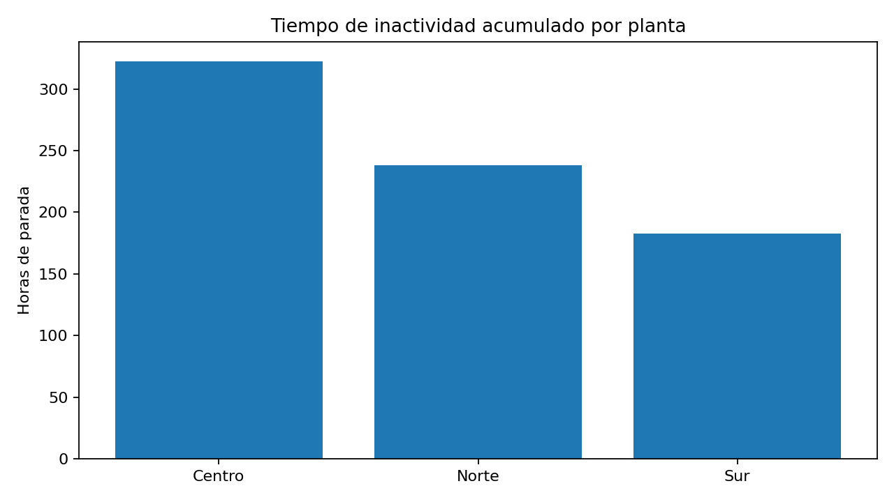

# 📊 Análisis de Eficiencia Operativa | Python + Pandas


> Proyecto de analítica de operaciones para transformar datos de producción en indicadores de rendimiento, visualizar pérdidas y formular recomendaciones accionables.

## 🎯 Problema de negocio

Una empresa manufacturera ficticia opera tres plantas y necesita responder:

1. ¿Qué planta aprovecha mejor su tiempo de producción?
2. ¿Cuánto afectan las paradas y los defectos a la eficiencia?
3. ¿Cómo cambia el rendimiento durante seis meses?
4. ¿Dónde conviene priorizar investigaciones de mejora operacional?

**Objetivo:** medir la eficiencia con KPIs reproducibles y establecer prioridades de optimización.

## 🧰 Tecnologías

- **Python:** automatización del análisis.
- **Pandas y NumPy:** generación, validación, limpieza y agrupación.
- **Matplotlib:** gráficos ejecutivos.
- **Pytest y GitHub Actions:** controles automáticos de calidad.

## 📁 Estructura del repositorio

```text
eficiencia-operativa-analytics/
├── .github/workflows/tests.yml  # Integración continua
├── data/
│   ├── DICCIONARIO.md          # Esquema de datos y reglas
│   └── operaciones.csv         # Datos sintéticos
├── reports/
│   ├── figures/                # Gráficos PNG
│   ├── indicadores.json        # KPIs totales
│   ├── kpis_por_mes.csv
│   ├── kpis_por_planta.csv
│   ├── kpis_por_turno.csv
│   └── resultados.md           # Informe generado
├── src/
│   ├── __init__.py
│   ├── analisis.py
│   ├── ejecutar.py
│   └── generar_datos.py
├── tests/test_analisis.py
├── .gitignore
├── LICENSE
├── requirements.txt
├── requirements-dev.txt
└── README.md
```

## 🚀 Cómo ejecutar el proyecto

Necesitas Python 3.11 o posterior.

```bash
git clone https://github.com/TU_USUARIO/eficiencia-operativa-analytics.git
cd eficiencia-operativa-analytics
python -m venv .venv
```

Activa el entorno virtual:

```bash
# Linux / macOS
source .venv/bin/activate

# Windows PowerShell
.venv\Scripts\Activate.ps1
```

Instala las dependencias y ejecuta el análisis desde la raíz:

```bash
python -m pip install -r requirements-dev.txt
python -m src.generar_datos
python -m src.ejecutar
python -m pytest -q
```

> `TU_USUARIO` es un marcador: reemplázalo por tu nombre de usuario de GitHub. El CSV ya está incluido, por lo que regenerarlo es opcional. Usa la misma semilla para obtener los mismos resultados.

## 📏 KPIs y metodología

| KPI | Interpretación |
|---|---|
| Disponibilidad | Proporción de tiempo planificado en operación |
| Rendimiento | Producción real respecto a capacidad ideal operativa |
| Calidad | Porcentaje de unidades sin defectos |
| **OEE** | Disponibilidad × Rendimiento × Calidad |
| Cumplimiento | Unidades buenas / objetivo |
| Energía por unidad buena | Eficiencia del consumo energético |

Las definiciones detalladas están en [el diccionario de datos](data/DICCIONARIO.md).

## 📈 Resultados y visualizaciones

Consulta el informe completo en [reports/resultados.md](reports/resultados.md).







## 💡 Recomendaciones de negocio

- Investigar primero las plantas con menor OEE, diferenciando pérdidas de disponibilidad, velocidad y calidad.
- Comparar los resultados de los turnos y construir un registro de **causas de parada**.
- Revisar las prácticas de la planta de mejor desempeño y evaluar si son transferibles.
- Definir metas basadas en características reales de cada línea, no en umbrales universales.
- Validar futuras mejoras mediante datos reales y pruebas antes/después.

## 🔍 Calidad del análisis y limitaciones

**Todos los datos son sintéticos** (generados por código con una semilla fija) y corresponden a enero-junio de 2025. No representan una empresa real ni permiten inferir demanda de empleo, tendencias sectoriales o beneficios financieros reales.

El análisis es **descriptivo**, no causal. Los campos de costo y energía son simulaciones; no deben utilizarse para decisiones de inversión. El OEE se calcula con una velocidad ideal homogénea; si se usan velocidades distintas por línea, se deben revisar los factores de agregación.

## 🗺️ Próximos pasos

- Incorporar registros de motivos de parada y análisis de Pareto.
- Desarrollar un panel interactivo en Power BI o Streamlit.
- Incorporar objetivos y alertas por planta/turno.
- Medir impacto de intervenciones con datos reales.

## 👤 Cómo presentar este proyecto

**Rol simulado:** Analista de Datos / Analista de Eficiencia Operativa.

**Competencias demostradas:** modelado de KPIs, validación, análisis exploratorio, visualización, automatización, pruebas y comunicación de hallazgos.

## 📄 Licencia

MIT. Puedes reutilizar el código con atribución. Los datos incluidos fueron generados sintéticamente para esta demostración.
