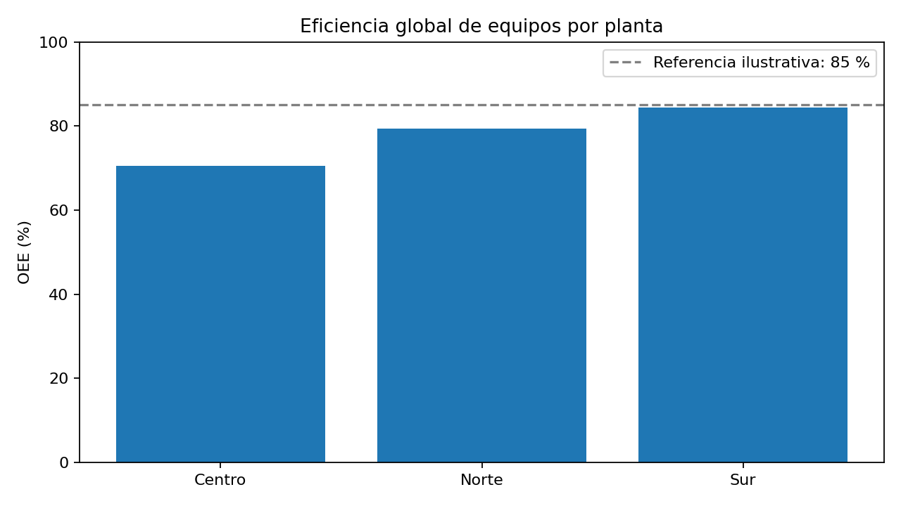
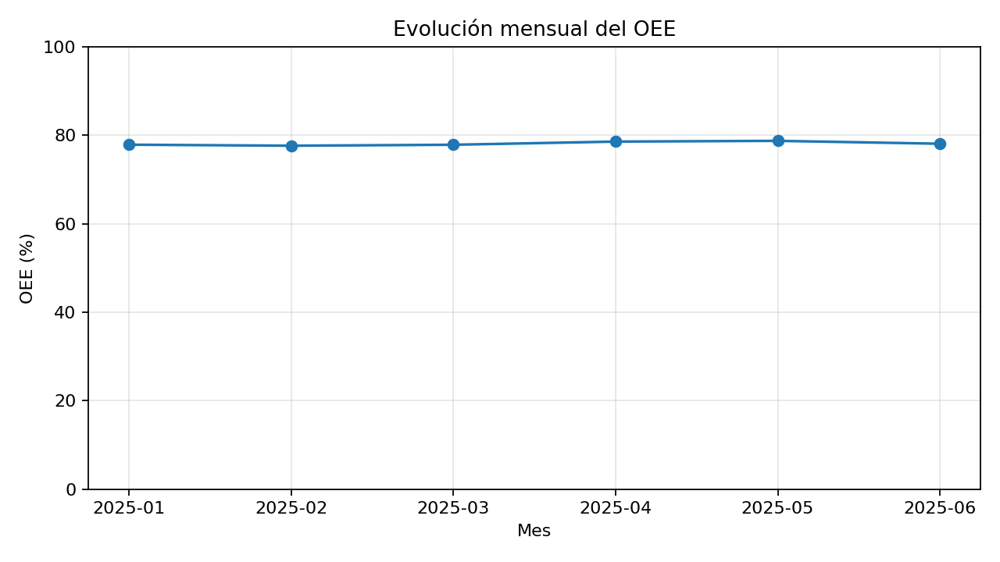
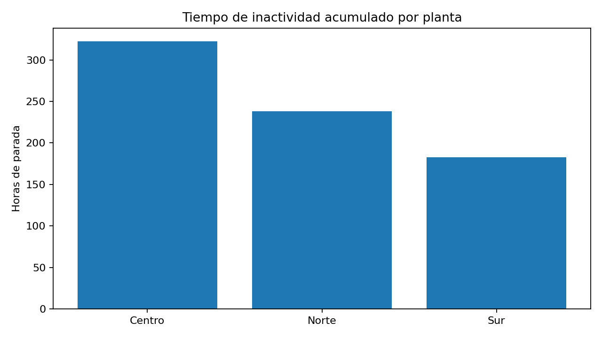

# Resultados del análisis

> Datos 100 % sintéticos. No representan una empresa real.

## Indicadores generales

| Indicador | Resultado |
|---|---:|
| Turnos analizados | 1,086 |
| Unidades buenas | 407,150 |
| Disponibilidad | 91.4% |
| Rendimiento | 88.7% |
| Calidad | 96.3% |
| **OEE global** | **78.1%** |
| Cumplimiento del objetivo | 96.1% |
| Energía por unidad buena | 0.440 kWh |

## Comparación entre plantas

| Planta | OEE | Disponibilidad | Calidad | Horas de parada |
|---|---:|---:|---:|---:|
| Centro | 70.6% | 88.9% | 94.5% | 322.3 |
| Norte | 79.4% | 91.8% | 96.7% | 238.2 |
| Sur | 84.3% | 93.7% | 97.4% | 182.6 |

## Hallazgos y acciones sugeridas

1. **Priorizar Centro**: presenta el menor OEE (70.6%). Revisar causas de paradas, mantenimiento preventivo y estándares de producción.
2. **Tomar Sur como referencia interna**: su OEE es 84.3%. Evaluar qué prácticas podrían transferirse entre plantas.
3. Segmentar pérdidas por turno y validar hipótesis con registros de causas de parada reales.
4. No interpretar la mejora sintética de abril como efecto causal de una intervención.

## Visualizaciones

## Limitaciones

El estudio es demostrativo y descriptivo, sin inferencia causal, sin incertidumbre estadística
estimada y sin demanda observada del mundo real. La referencia de OEE de 85 % es ilustrativa;
no debe usarse como meta universal sin conocer el proceso industrial.
